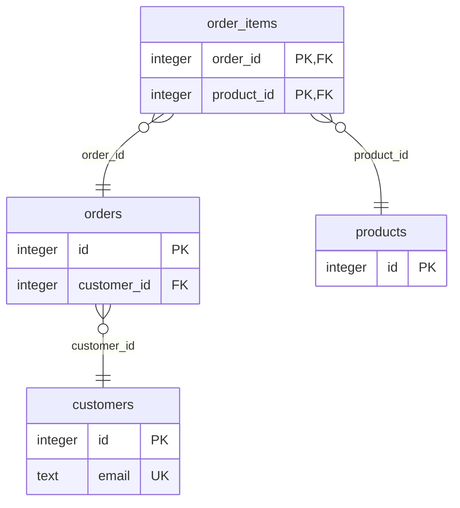

# pg-explorer-mcp

[English](README.md) | **Русский**

До версии 0.8.0 сервер назывался pg-mcp. Что сделать после обновления, сказано в разделе
[«Обновление и удаление»](#обновление-и-удаление).

[](https://github.com/dbelokursky/pg-explorer-mcp/actions/workflows/tests.yml)
[](https://github.com/dbelokursky/pg-explorer-mcp/releases)
[](https://github.com/dbelokursky/pg-explorer-mcp/releases)
[](LICENSE)

MCP-сервер, который даёт агенту доступ **только на чтение** к базе PostgreSQL, а через одну запись — и к
[десяткам стендов](#много-стендов). Агент видит структуру базы, может посмотреть примеры строк и
планы запросов, а аналитики — выполнять свои `SELECT`.
Изменить данные, структуру или настройки базы через этот сервер нельзя.

Сделан для GigaCode CLI и Qwen Code, но подходит любому клиенту MCP, который запускает серверы через
stdio. Работает на Python 3.9+ без установки пакетов: драйвер pg8000 лежит в репозитории. Отвечает
по-английски или по-русски.

## Содержание

- [Что умеет](#что-умеет)
- [Быстрый старт](#быстрый-старт)
- [Попробовать на демо-базе](#попробовать-на-демо-базе)
- [Установка по шагам](#установка-по-шагам)
- [Как пользоваться](#как-пользоваться)
- [Много стендов](#много-стендов)
- [Профили групп](#профили-групп)
- [Язык](#язык)
- [Безопасность](#безопасность)
- [Журнал запросов](#журнал-запросов)
- [Настройки](#настройки)
- [Для DBA: роль для агента](#для-dba-роль-для-агента)
- [Если что-то не работает](#если-что-то-не-работает)
- [Обновление и удаление](#обновление-и-удаление)
- [Вопросы и ответы](#вопросы-и-ответы)
- [Разработка](#разработка)

## Что умеет

| Инструмент | Что делает | Профили |
|---|---|---|
| `status` | к какой базе подключён, под какой ролью, какой профиль и язык, какие лимиты; при сбое — что исправить | все |
| `list_schemas` | для [многих стендов](#много-стендов): базы стенда и их схемы, для которых у сервера есть учётки | все |
| `list_tables` | таблицы, представления и внешние таблицы, доступные роли, с оценкой числа строк и комментариями | все |
| `search_schema` | таблицы, представления и колонки, в имени или комментарии которых есть фрагмент, во всех доступных схемах; для больших баз | все |
| `describe_table` | колонки с типами, `NOT NULL`, значениями по умолчанию и комментариями; ключи, ссылки на таблицу, индексы | все |
| `schema_diagram` | модель данных как диаграмма Mermaid, которую агент показывает картинкой: таблицы схемы с ключами и внешними ключами или одна таблица с соседями | все |
| `compare_schema` | для [многих стендов](#много-стендов): чем одна схема на одном стенде отличается от другого: таблицы и представления, колонки, ограничения, индексы | все |
| `sample_rows` | несколько строк таблицы, можно выбрать колонки | `explore`, `analyst` |
| `explain_query` | план запроса без выполнения; в профиле `analyst` — и с реальным временем (`ANALYZE`) | `explore`, `analyst` |
| `run_select` | один запрос только на чтение: `SELECT`, `WITH … SELECT`, `VALUES`, `TABLE`, `EXPLAIN`, `SHOW` | `analyst` |

Профиль выбирает администратор группы при установке: [подробнее](#профили-групп).

## Быстрый старт

Нужны Python 3.9+, GigaCode CLI (или Qwen Code) и роль в базе, которую выдал DBA.

```bash
git clone https://github.com/dbelokursky/pg-explorer-mcp.git
cd pg-explorer-mcp
export PGHOST=db.example.com PGDATABASE=app PGUSER=mcp_agent   # где база и под какой ролью
python3 install.py --lang ru                                     # регистрация и проверка
gigacode extensions link "$(pwd)"                                # контекст и команда /pg:setup
```

Пароль положите в `~/.pgpass` ([как](#4-пароль--в-файл-паролей)), перезапустите GigaCode и спросите
агента: «Проверь подключение к базе».

Можно и короче: подключите расширение (`gigacode extensions link`), перезапустите GigaCode и
выполните в нём `/pg:setup`. Агент сам найдёт Python, запустит `install.py` и разберёт подсказки.

## Попробовать на демо-базе

Ответы в разделе [Как пользоваться](#как-пользоваться) взяты с маленькой демо-базы: магазин, который
агент читает, и схема `hr`, которую не читает. `scripts/demo.py` создаёт её на любом PostgreSQL, где
ваши переменные `PG*` могут создать базу и роль (подойдёт свежий локальный PostgreSQL):

```bash
python3 scripts/demo.py                                     # pg_mcp_demo и роль mcp_demo_agent с паролем demo
echo "localhost:5432:pg_mcp_demo:mcp_demo_agent:demo" >> ~/.pgpass && chmod 600 ~/.pgpass
PGDATABASE=pg_mcp_demo PGUSER=mcp_demo_agent python3 install.py --profile analyst
```

Перезапустите агента и спросите: «Сколько заказов в каждом статусе?», «Опиши таблицу заказов», «Что
в схеме hr?». Данные одинаковы на любой копии (`docs/demo.sql` строит их арифметикой, без `random()`),
поэтому ответы агента совпадут с примерами в этом README. `python3 scripts/demo.py --drop` удаляет базу
и роль.

## Установка по шагам

### 1. Код

```bash
git clone https://github.com/dbelokursky/pg-explorer-mcp.git
```

Без git: возьмите `pg-explorer-mcp-<версия>.zip` из последнего выпуска на
[странице Releases](https://github.com/dbelokursky/pg-explorer-mcp/releases) и распакуйте его в любую папку: внутри папка
`pg-explorer-mcp` со всем, что нужно серверу, а рядом с архивом лежит `SHA256SUMS` с его контрольной суммой.
У архива есть аттестация происхождения: `gh attestation verify pg-explorer-mcp-<версия>.zip --repo
dbelokursky/pg-explorer-mcp` подтверждает, что его собрал GitHub из тега этого репозитория. Папку потом не
переносите: путь к ней записывается в настройки агента. Если всё же перенесли — повторите шаг 5.

### 2. Python 3.9 или новее

| Система | Как проверить | Где взять |
|---|---|---|
| macOS | `python3 --version` | приходит с Command Line Tools (их ставит `git`) |
| Linux | `python3 --version` | пакет `python3` дистрибутива |
| Windows | `py -3 --version` или `python --version` | установщик с python.org или архив «embeddable package»: он распаковывается без прав администратора |

Ставить пакеты через pip не нужно.

### 3. Где база

Сервер читает те же переменные окружения, что и `psql`. Задайте их в терминале, из которого
запустите `install.py`: скрипт перенесёт их в настройки сервера.

macOS и Linux:

```bash
export PGHOST=db.example.com PGPORT=5432 PGDATABASE=app PGUSER=mcp_agent
```

Windows (PowerShell):

```powershell
$env:PGHOST = "db.example.com"; $env:PGDATABASE = "app"; $env:PGUSER = "mcp_agent"
```

Для TLS с проверкой сертификата добавьте `PGSSLMODE=verify-full` и `PGSSLROOTCERT=<путь к CA>`.
Все переменные — в [настройках](#настройки).

### 4. Пароль — в файл паролей

Пароль хранится только в файле паролей PostgreSQL, тот же файл читает `psql`. Не вставляйте пароль
в настройки агента и не отправляйте его в чат.

macOS и Linux — файл `~/.pgpass`:

```bash
nano ~/.pgpass        # или любой другой редактор
chmod 600 ~/.pgpass   # иначе файл будет проигнорирован: его могут прочитать другие
```

Windows — файл `%APPDATA%\postgresql\pgpass.conf`:

```powershell
mkdir "$env:APPDATA\postgresql" -Force
notepad "$env:APPDATA\postgresql\pgpass.conf"
```

Одна строка на подключение: `хост:порт:база:роль:пароль`. Звёздочка подходит к любому значению,
двоеточие и обратную косую черту внутри значения экранируйте: `\:` и `\\`.

```text
db.example.com:5432:app:mcp_agent:пароль-от-DBA
```

### 5. Регистрация в агенте

```bash
python3 install.py                              # GigaCode, профиль explore, язык — по локали системы
python3 install.py --profile analyst --lang ru  # профиль и язык явно
python3 install.py --client qwen                # Qwen Code вместо GigaCode
py -3 install.py                                # Windows
```

Что делает скрипт:

1. сохраняет копию настроек агента (`~/.gigacode/settings.json.bak-<дата>`);
2. добавляет в `mcpServers` сервер `pg`: тот же Python, которым запущен скрипт, путь к `run.py`,
   переменные `PG*` из терминала (кроме `PGPASSWORD`), профиль и язык;
3. запускает сервер так же, как агент, вызывает `status` и печатает ответ. Код выхода 0 означает,
   что база доступна.

`python3 install.py --check` только запускает сервер и вызывает `status`, ничего не меняя.

Так выглядит запись в `~/.gigacode/settings.json` после `install.py --profile analyst --lang ru`:

```json
{
  "mcpServers": {
    "pg": {
      "command": "/usr/bin/python3",
      "args": ["-I", "/Users/me/pg-explorer-mcp/run.py"],
      "timeout": 30000,
      "env": {
        "PGHOST": "db.example.com",
        "PGDATABASE": "app",
        "PGUSER": "mcp_agent",
        "PG_EXPLORER_MCP_PROFILE": "analyst",
        "PG_EXPLORER_MCP_LANG": "ru"
      }
    }
  }
}
```

Если в `settings.json` есть комментарии, скрипт не станет его переписывать и напечатает фрагмент,
который нужно добавить вручную.

#### Несколько баз

Один клон обслуживает сколько угодно баз: каждую следующую регистрируйте под своим именем. Её запись
называется `pg-<имя>` и стоит рядом с `pg`, со своим подключением, профилем, языком и журналом:

```bash
PGDATABASE=sales python3 install.py --name sales
PGDATABASE=hr PGUSER=mcp_hr python3 install.py --name hr --profile schema
```

Тогда агент получает инструменты всех записей, а `status` каждой называет свой сервер и базу.

#### Другие агенты и редакторы

`--client` регистрирует сервер и в других клиентах MCP — каждому в его файл и в его формате:

| `--client` | Куда попадает запись |
|---|---|
| `gigacode` (по умолчанию), `qwen` | `~/.gigacode/settings.json`, `~/.qwen/settings.json` |
| `vscode` | пользовательский `mcp.json` VS Code (GitHub Copilot в режиме агента), раздел `servers` |
| `cursor` | `~/.cursor/mcp.json` |
| `windsurf` | Windsurf, теперь Devin Desktop: `~/.config/devin/mcp_config.json` или прежний файл, если он уже есть |
| `cline` | `~/.cline/data/settings/cline_mcp_settings.json`, общий для Cline в VS Code, JetBrains и его CLI |
| `roo` | файл настроек расширения Roo Code в VS Code (расширение больше не развивается) |
| `continue` | файл-блок `~/.continue/mcpServers/pg.yaml` |
| `lmstudio` | `~/.lmstudio/mcp.json` |
| `claude-desktop` | `claude_desktop_config.json` приложения |
| `junie` | `~/.junie/mcp/mcp.json` |
| `jetbrains` | ничего не пишется: AI Assistant хранит серверы в настройках, запись печатается для вставки |

```bash
python3 install.py --client cursor            # записать в файл Cursor (с копией) и проверить
python3 install.py --client vscode --print    # только показать запись и куда её положить
```

`--print` подходит для клиента, которого нет в списке, или если файл хочется поправить самому. Файл с
комментариями не переписывается никогда: `install.py` печатает, что в него добавить. При запуске в
терминале `install.py`, зарегистрировав сервер, находит другие установленные на машине клиенты и
предлагает добавить его и туда. Расширение (контекст и команды `/pg:`) есть только для GigaCode CLI и
Qwen Code.

### 6. Расширение

```bash
gigacode extensions link /путь/к/pg-explorer-mcp     # для Qwen Code: qwen extensions link …
```

Расширение даёт агенту короткий контекст (с чего начинать, что пароль в чат не просят, отвечать на
языке пользователя), команду `/pg:setup` для установки и починки, `/pg:import` для переноса
подключений к стендам из DBeaver или `pg_service.conf` и `/pg:diagram`, чтобы нарисовать модель данных и
сохранить её рядом с проектом.

### 7. Проверка

Перезапустите GigaCode, чтобы он запустил сервер с новыми настройками, и спросите: «Проверь
подключение к базе». Агент вызовет `status` и перескажет ответ.

## Как пользоваться

Говорите с агентом обычными словами — инструменты он выберет сам.

| Вы спрашиваете | Агент вызывает |
|---|---|
| «Проверь подключение к базе» | `status` |
| «Какие таблицы есть в схеме shop?» | `list_tables` |
| «Где у нас хранятся цены?» | `search_schema` |
| «Опиши таблицу заказов» | `describe_table` |
| «Нарисуй модель данных магазина» | `schema_diagram` |
| «Покажи несколько заказов» | `sample_rows` |
| «Почему этот запрос медленный: …» | `explain_query` |
| «Сколько заказов в каждом статусе?» | `run_select` (профиль `analyst`) |

Ниже — настоящие ответы инструментов на демонстрационной базе: их видит модель, а в интерфейсе
агента — и вы.

`status`:

```text
pg-explorer-mcp 0.7.0 на Python 3.9.6, установлен в /Users/me/pg-explorer-mcp
имя сервера: pg
доступ: только чтение. Добавить, изменить или удалить данные через этот сервер нельзя: от таких просьб отказывайтесь, а не просите пользователя их подтвердить.
адрес: mcp_demo_agent@localhost:5432/pg_mcp_demo (sslmode=prefer)
профиль: analyst (status, list_tables, search_schema, describe_table, schema_diagram, sample_rows, explain_query, run_select)
язык: ru
журнал запросов: выключен
база: подключено к pg_mcp_demo под ролью mcp_demo_agent, PostgreSQL 16.15
лимиты: только чтение = on, таймаут запроса = 5s, list_tables возвращает не больше 200 записей, ответы обрезаются до 8000 символов
```

`list_tables` — комментарии к таблицам помогают модели понять, что где лежит:

```text
shop.customers | таблица | ~50 строк | Покупатели
shop.order_items | таблица | ~2,2 тыс. строк | Позиции заказов: цена фиксируется на момент заказа
shop.orders | таблица | ~500 строк | Заказы
shop.products | таблица | ~20 строк | Каталог товаров
```

`search_schema` с `text: "цена"` находит таблицу по комментарию:

```text
shop.order_items | таблица | ~2,2 тыс. строк | Позиции заказов: цена фиксируется на момент заказа
```

`describe_table` для `shop.orders`:

```text
shop.orders | таблица | ~500 строк | Заказы
колонки:
  id integer NOT NULL
  customer_id integer NOT NULL
  status text NOT NULL  -- new, paid, shipped или cancelled
  created_at timestamp with time zone NOT NULL
ограничения:
  orders_pkey: PRIMARY KEY (id)
  orders_customer_id_fkey: FOREIGN KEY (customer_id) REFERENCES shop.customers(id)
  orders_status_check: CHECK (status = ANY (ARRAY['new'::text, 'paid'::text, 'shipped'::text, 'cancelled'::text]))
на неё ссылаются:
  shop.order_items: FOREIGN KEY (order_id) REFERENCES shop.orders(id)
индексы:
  CREATE INDEX orders_created_idx ON shop.orders USING btree (created_at)
  CREATE INDEX orders_customer_idx ON shop.orders USING btree (customer_id)
  CREATE UNIQUE INDEX orders_pkey ON shop.orders USING btree (id)
```

`schema_diagram` со `schema: shop` отвечает текстом диаграммы Mermaid, которую агент показывает картинкой;
`columns: all` добавляет все колонки с комментариями, а `table` с `depth` рисует одну таблицу с соседями по
внешним ключам:



`sample_rows` с `columns: "id, status, created_at"` и `limit: 3`:

```text
shop.orders:
id | status | created_at
1 | shipped | 2026-01-01 09:00:00+02:00
2 | paid | 2026-01-01 16:00:00+02:00
3 | cancelled | 2026-01-01 23:00:00+02:00
(показаны 3 строки, есть ещё: сузьте запрос через WHERE, ORDER BY или LIMIT)
```

Ошибка — тоже подсказка: модель видит, что исправить, и пробует снова.

```text
В shop.orders нет колонки 'total'. Колонки: id, customer_id, status, created_at.
Команда DELETE запрещена. Разрешены только команды на чтение: SELECT, WITH ... SELECT, VALUES, TABLE, EXPLAIN и SHOW.
Среди доступных для чтения нет таблицы или представления 'salaries' в схеме 'hr'. Вызовите list_tables, чтобы увидеть, что есть.
```

Последняя строка — схема `hr`, на которую у роли нет прав: её таблиц инструменты не показывают.

### Лимиты

| Что | Сколько |
|---|---|
| Записей в `list_tables` | не больше 200; передайте `schema`, чтобы сузить |
| Совпадений в `search_schema` | не больше 100 |
| Строк в `sample_rows` | 10 по умолчанию, не больше 50 |
| Строк в `run_select` | не больше 200 |
| Строк плана | не больше 500 |
| Одно значение в ответе | не длиннее 200 символов |
| Весь ответ инструмента | 8000 символов (`PG_EXPLORER_MCP_MAX_RESPONSE_CHARS`) |
| Время одного запроса | 5 секунд (`PG_EXPLORER_MCP_STATEMENT_TIMEOUT_MS`) |
| Открытых подключений у записи стендов | не больше 8 (`PG_EXPLORER_MCP_MAX_CONNECTIONS`) |
| Стендов в одном вызове (`stands`) | не больше 100, опрашиваются одновременно; строки `run_select` и совпадения `search_schema` делятся между ними, не меньше 10 на стенд |

Если ответ длиннее бюджета, он обрезается по целым строкам, а последняя строка говорит, сколько
показано. Локальные модели работают с небольшим контекстом, и слишком длинный ответ может оборвать
сессию агента.

## Много стендов

Когда стендов десятки (`dev1`–`dev50`, `ift1`–`ift3`), на каждом по несколько баз, а у каждой схемы своя
учётка, запись на каждое подключение стоила бы модели тысяч символов описаний инструментов в каждом
запросе. Вместо этого одна запись обслуживает все стенды: инструменты описаны один раз, а в каждом
вызове названы стенд и схема.

**1. Реестр.** Подключения хранятся в формате `pg_service.conf` из libpq: секция на схему с именем
`стенд.база.схема`:

```ini
[dev7.demo.shop]
host=dev7-db.example.com

[dev7.demo.hr]
host=dev7-db.example.com

[ift2.demo.shop]
host=ift2-db.example.com
port=6432
user=shop_reader
```

- обязателен только `host`; `port` (5432), `dbname` (часть имени про базу), `user` (имя схемы),
  `sslmode`, `sslrootcert` и `connect_timeout` (10 секунд) — по желанию;
- `host` может перечислить несколько хостов через запятую, как в libpq: `host=h1,h2` с одним `port` на оба
  или `port=6544,6545` — по порту на хост. Сервер пробует их по порядку и берёт первый, который пустил, так
  что стенд с резервным хостом отвечает, пока основной лежит; если не пустил ни один, ошибка называет
  каждый;
- пароли — в файл паролей, строка на учётку, как и для одной базы;
- сервер читает `~/.pg-explorer-mcp/stands.conf` (на Windows `%APPDATA%\pg-explorer-mcp\stands.conf` или файл из
  `PG_EXPLORER_MCP_STANDS_FILE`) и ваш `~/.pg_service.conf`; при одинаковых именах побеждает первый файл.
  Пока в новой папке нет `stands.conf`, читается тот, что pg-mcp 0.7.0 записал в `~/.pg-mcp/`, и импорт с
  выгрузками работают с той же папкой. Секции с другими именами — обычные сервисы psql, сервер их не трогает;
- те же секции понимает psql: `psql service=dev7.demo.shop`.

**2. Запись.**

```bash
PG_EXPLORER_MCP_STANDS='*' python3 install.py --name stands
```

Это регистрирует `pg-stands` рядом с `pg`. `PG_EXPLORER_MCP_STANDS` включает стенды: `*` — все, шаблоны вроде
`dev*,ift2` — некоторые. Проверка проходит, когда стенды найдены: к стенду за VPN сервер подключается,
только когда он нужен инструменту.

**Импорт подключений.** Если подключения уже есть в DBeaver или в файле `pg_service.conf`, их
перенесёт `install.py`:

```bash
python3 install.py import dbeaver            # предпросмотр: что куда попадёт, ничего не записывается
python3 install.py import dbeaver --write    # записать реестр и файл паролей, зарегистрировать pg-stands
python3 install.py import pg-service ~/.pg_service.conf --write
```

Стенд берётся из папки DBeaver, затем из имени подключения, затем из хоста — по регулярному
выражению `(dev|ift)[-_ ]?\d+` (`--stand-pattern` его меняет); разделитель между буквами и числом
отбрасывается, так что `DEV-27` — это стенд `dev27`. Подключение, в котором шаблон ничего не нашёл,
получает стендом своё имя: `IFT-Caldera` становится `ift-caldera`, и предпросмотр это отмечает. База —
та, что в подключении, сначала из его URL; схема — его учётка, ведь на стенде у каждой схемы учётка с
тем же именем. Предпросмотр перечисляет, что будет
записано и что пропущено и почему; пароли не показываются никогда. `--write` переписывает
`~/.pg-explorer-mcp/stands.conf` (дополняя то, что там есть, или заменяя с `--prune`), добавляет пароли в файл
паролей, не трогая остальные его строки, оставляет датированную копию обоих файлов и регистрирует
`pg-stands`; при любом сбое ничего не меняется. Сохранённые пароли DBeaver читаются из его файлов,
пока DBeaver хранит их под своим ключом по умолчанию; при включённом защищённом хранилище они
остаются неизвестны, и предпросмотр называет учётки, которым строку в файл паролей нужно добавить
вручную. Агент делает то же командой `/pg:import` и записывает только после вашего подтверждения.
Работающий сервер замечает изменённый реестр при следующем вызове, так что перезапуск агента не
нужен; файл реестра со строкой `password=`, который могут читать другие пользователи, получает
предупреждение в `status`. Подключение DBeaver с несколькими хостами (`h1:6544,h2` с портом 6544, как
пишет DBeaver, или URL `jdbc:postgresql://h1:6544,h2:6544/db`) сохраняет их все, а в файл паролей
попадает строка на каждый хост: libpq сверяет строку с одним хостом.

**Выгрузка подключений в инструменты БД.** В обратную сторону `install.py export` кладёт стенды в
инструменты, где вы работаете с ними сами: по папке или группе на стенд, каждое подключение входит по
файлу паролей. Пароли никуда не копируются.

```bash
python3 install.py export dbeaver                # предпросмотр: что куда попадёт, ничего не записывается
python3 install.py export dbeaver --write
python3 install.py export pgadmin --write --stands 'dev*,ift2'
```

| Инструмент | `export` | Что пишет | Дальше |
|---|---|---|---|
| DBeaver | `dbeaver` | `data-sources-pg-mcp.json` рядом с `data-sources.json` DBeaver или в папке из `--workspace` | Перезапустить DBeaver |
| DataGrip и IDE JetBrains с инструментами БД | `datagrip` | `.idea/dataSources.xml` и `dataSources.local.xml` в `~/.pg-explorer-mcp/datagrip` или в проекте из `--project` (сначала закройте его) | Открыть папку как проект |
| pgAdmin 4 | `pgadmin` | `~/.pg-explorer-mcp/pgadmin-servers.json` | Tools > Import/Export Servers > Import |
| psql, pgcli | `pg-service` | Секции `~/.pg_service.conf`, схема первой в search_path | `psql "service=dev7.demo.shop"` |
| Расширение PostgreSQL для VS Code (Microsoft) | `vscode-pgsql` | `pgsql.connections` в настройках пользователя; для Cursor и Windsurf — `--editor cursor` или `windsurf` | Перезагрузить окно |
| SQLTools | `sqltools` | `sqltools.connections` в настройках пользователя, с пустым паролем | Перезагрузить окно |

Стенд с несколькими хостами уходит в psql, DBeaver и DataGrip со всеми хостами. У pgAdmin и расширения
PostgreSQL одно поле порта, поэтому они получают список, когда порт у хостов один, и первый хост иначе;
SQLTools подключается к одному хосту и получает первый.

Выгрузка заменяет только свои подключения — по постоянному идентификатору или по имени — и оставляет
остальное: сделанное вами в инструменте и выгруженное раньше для других стендов. У каждого изменённого
файла остаётся датированная копия, права файла сохраняются, а файл-ссылка остаётся ссылкой. Подключения,
которые уже есть в DBeaver с тем же хостом, портом, базой и пользователем, пропускаются: чаще всего
стенды пришли как раз из DBeaver. В `~/.pg_service.conf` каждая выгруженная секция стоит под строкой
`# pg-explorer-mcp export`: следующая выгрузка переписывает только такие секции, сервер не считает их стендами,
а одноимённая секция, которую вы написали сами, остаётся как есть, и её стенд пропускается. Настройки
TLS стенда, `sslmode` и `sslrootcert`, переносятся тоже. Файл настроек с комментариями не трогается:
выгрузка печатает, что добавить в него вручную. Расширение
PostgreSQL от Microsoft не умеет читать файл паролей: оно спросит каждый пароль один раз и сохранит его
в системной связке ключей. Повторный импорт файла в pgAdmin добавит серверы ещё раз, поэтому старые
сначала удалите. После `import --write`, а также после регистрации записи, если стенды уже есть,
`install.py` в терминале ищет эти инструменты на машине и предлагает выгрузить стенды в них.

**3. Работа.** Каждый инструмент принимает `stand`. Для чтения данных нужна и `schema`: сервер
подключается под учёткой этой схемы и ищет имена без схемы сначала в ней. `database` нужна, только если
схема есть в нескольких базах стенда.

| Вы просите | Агент вызывает |
|---|---|
| «Какие есть стенды?» | `status` |
| «Доступен ли dev7?» | `status` со `stand` |
| «Какие схемы на dev7?» | `list_schemas` |
| «Где на dev7 лежат заказы?» | `search_schema` со `stand` и `text` |
| «Нарисуй модель данных shop на dev7» | `schema_diagram` со `stand` и `schema` |
| «Сколько заказов в каждом статусе в shop на dev7?» | `run_select` со `stand` и `schema` (профиль `analyst`) |
| «На каком dev-стенде есть заказ 123?» | `run_select` со `stands` и `schema` |
| «На каких стендах в shop есть колонка со скидкой?» | `search_schema` со `stands` и `text` |
| «Чем shop на dev7 отличается от dev12?» | `compare_schema` со `stand_a`, `stand_b` и `schema` |
| «Какие dev-стенды отличаются от dev7 в shop?» | `compare_schema` со `stand_a`, `stands` и `schema` |

Каждый ответ начинается с того, откуда он. Настоящие ответы на демо-базе:

`list_schemas` со `stand: dev7`:

```text
dev7 / demo: hr, shop
```

`run_select` со `stand: dev7` и `schema: shop`:

```text
dev7 / demo / shop
status | count
shipped | 174
paid | 162
cancelled | 90
new | 74
(4 строки)
```

`compare_schema` со `stand_a: dev7`, `stand_b: dev12` и `schema: shop`, где dev12 — копия демо-базы, в
которой у цены прибавилось два разряда, у заказов появились заметка и таблица возвратов, а индекс удалён:

```text
dev7 / demo / shop  vs  dev12 / demo / shop
только на dev12:
  shop.returns | таблица
отличаются:
  shop.order_items.price: dev7 numeric(10,2) NOT NULL | dev12 numeric(12,2) NOT NULL
  shop.orders.note только на dev12: text
  shop.orders: индекс orders_customer_idx только на dev7: CREATE INDEX orders_customer_idx ON shop.orders USING btree (customer_id)
```

`compare_schema` со `stand_a: dev7`, `stands: dev*` и `schema: shop` — подходящие стенды, каждый против
dev7; до трёх стендов получают полные различия, больше — по строке с числами:

```text
dev7 / demo / shop  против стендов: 3
dev8 / demo / shop: как dev7
dev9 / demo / shop: как dev7
dev12 / demo / shop
только на dev12:
  shop.returns | таблица
отличаются:
  shop.order_items.price: dev7 numeric(10,2) NOT NULL | dev12 numeric(12,2) NOT NULL
  shop.orders.note только на dev12: text
  shop.orders: индекс orders_customer_idx только на dev7: CREATE INDEX orders_customer_idx ON shop.orders USING btree (customer_id)
как dev7: 2; отличаются: 1; не проверены: 0
```

Структура берётся из системного каталога каждого стенда под учёткой схемы, тремя запросами на стенд при
любом числе таблиц; данные не читаются. Схема без различий даёт одну строку вроде `одинаково: 1 таблица,
3 колонки`, а схема, которая есть в реестре, но не в базе одного из стендов, — ошибку, а не стенд,
полный различий.

Без `schema` инструменты `list_tables`, `search_schema` и `describe_table` охватывают весь стенд: имена
берутся из системного каталога, который видит любая учётка, через одну учётку на базу, и показываются
только схемы из реестра. Данные остаются за правами каждой схемы: учётка без доступа к соседней схеме
получит там `permission denied`.

**4. Несколько стендов сразу.** `search_schema` и `run_select` принимают вместо `stand` аргумент `stands`:
имена стендов через запятую или шаблон, `dev1,dev2,dev3` или `dev*`, не больше 100 стендов за вызов.
Стенды опрашиваются одновременно, поэтому вызов длится столько, сколько самый медленный стенд, а не все
вместе; в ответе стенды идут в том порядке, в котором их перечисляет `status`, на каждый своя секция под
строкой `стенд / база / схема`. Недоступный стенд, стенд без учётки этой схемы или ошибка запроса на нём —
одна строка с объяснением под его заголовком, остальные стенды отвечают. Стенды, которые ответили без строк
или без совпадений, сворачиваются в одну строку с их именами: стенд, на котором нашлось то, что искали,
виден сразу. 200 строк `run_select` и 100 совпадений `search_schema` делятся между стендами, не меньше 10
на стенд, чтобы весь ответ уложился в бюджет. Вызов укладывается в 25 секунд из 30, которые ждёт клиент:
стенд, который за это время не ответил, так и называется, и агент спрашивает о нём отдельным вызовом.

`run_select` со `stands: dev*`, `schema: shop` и `SELECT count(*) FROM orders WHERE id = 123`:

```text
dev1 / demo / shop
count
1
(1 строка)
dev2 / demo / shop
count
0
(1 строка)
dev3 / demo / shop
  Подключение к dev3-db.example.com:5432 не дождалось ответа. Возможно, хост закрыт файрволом или нужен VPN.
```

Сбой остаётся маленьким. Недоступный стенд или сломанная учётка затрагивают только ответы, которым они
нужны, а `status` со `stand` пробует вторую учётку, если сервер отверг первую. Без `PG_EXPLORER_MCP_STANDS` или
если стендов не нашлось, запись работает по переменным `PG*`, как раньше, и `status` объясняет почему.
Открытыми держатся не больше 8 подключений (`PG_EXPLORER_MCP_MAX_CONNECTIONS`). Хост, который не ответил,
бросается через 10 секунд и до конца этого вызова больше не пробуется, что бы ещё ни было на нём у
стенда; вторая учётка базы пробуется, только когда сервер ответил и отверг первую. Причины решений — в
[ADR 0006](docs/adr/0006-stands.md).

## Профили групп

Профиль решает, какие инструменты увидит агент:

| Профиль | Инструменты | Кому |
|---|---|---|
| `schema` | `status`, `list_tables`, `search_schema`, `describe_table` | тем, кому нужна только структура: агент не видит ни одной строки данных |
| `explore` | плюс `sample_rows`, `explain_query` | разработчикам; профиль по умолчанию |
| `analyst` | плюс `run_select` и `explain_query` с `ANALYZE` | аналитикам, которым нужен свой SQL |

Задаётся при регистрации (`python3 install.py --profile schema`) или переменной `PG_EXPLORER_MCP_PROFILE` в
блоке `env` сервера. При неизвестном значении включается самый строгий профиль, `schema`, а `status`
предупреждает об этом. Профиль — удобство, а не граница доступа: что можно читать, решают права роли
в базе.

## Язык

Сервер говорит по-английски (`en`) или по-русски (`ru`): описания инструментов, ответы, подсказки,
отказы и вывод `install.py`. Язык выбирается так:

1. переменная `PG_EXPLORER_MCP_LANG` (её записывает `install.py --lang`);
2. иначе локаль системы: переменные `LANGUAGE`, `LC_ALL`, `LC_MESSAGES`, `LANG`, а на Windows —
   региональные настройки;
3. иначе английский.

`status` показывает текущий язык. Чтобы сменить его, выполните `python3 install.py --lang en` или
поправьте `PG_EXPLORER_MCP_LANG` в настройках и перезапустите агента.

Не переводятся имена инструментов и аргументов, ошибки протокола JSON-RPC, журнал сервера и
сообщения самого PostgreSQL: их язык задаёт настройка `lc_messages` базы.

Модель в любом случае просят отвечать на языке пользователя. Если модель группы хуже выбирает
инструменты по русским описаниям, поставьте `PG_EXPLORER_MCP_LANG=en`: отвечать она всё равно будет
по-русски. Почему сделано именно так — в [ADR 0004](docs/adr/0004-languages.md).

## Безопасность

Любое изменение данных, структуры, прав, настроек и чужих сессий запрещено. Защита из трёх слоёв,
и каждый работает, даже если остальные что-то пропустят:

1. **Роль в PostgreSQL** — настоящая граница: у неё только `SELECT` на выбранные схемы
   ([скрипт для DBA](#для-dba-роль-для-агента)).
2. **Транзакция `READ ONLY` на каждый запрос**, которая всегда откатывается, с таймаутом запроса и
   search_path схемы, заданными только для этой транзакции: пулер соединений в transaction-режиме между
   сервером и PostgreSQL (pgbouncer, Odyssey) ничего не меняет. Запрос уходит одной командой, так что
   строку `SELECT 1; COMMIT; DROP …` PostgreSQL отвергнет.
3. **Проверка текста запроса** пропускает только команды чтения и отвергает `INSERT`, `UPDATE`,
   `DELETE`, `MERGE`, `SELECT … INTO`, блокировки строк и функции с побочными эффектами
   (`pg_terminate_backend`, `set_config`, `dblink`, `pg_sleep` и другие), объясняя модели причину.

Полная политика — в [ADR 0002](docs/adr/0002-read-only-sql-policy.md).

Всё, что возвращают инструменты, попадает в контекст модели. С локальной моделью внутри организации
данные не покидают её, но выбирайте профиль по задаче: `schema` не показывает данных вовсе.

Пароли сервер берёт из [файла паролей](#4-пароль--в-файл-паролей), как и `psql`, и только из строки
своего входа.

## Журнал запросов

Чтобы вести журнал того, что агент спрашивал у базы, задайте `PG_EXPLORER_MCP_QUERY_LOG` — абсолютный путь
к файлу (`~` можно) — перед запуском `install.py` или добавьте её потом в блок `env` сервера:

```bash
export PG_EXPLORER_MCP_QUERY_LOG=~/pg-explorer-mcp-queries.jsonl
python3 install.py
```

Каждый вызов инструмента добавляет строку JSON. Эти две — настоящие, с демонстрационной базы:

```json
{"time": "2026-10-22T13:54:20.570Z", "os_user": "anna", "pid": 95715, "python": "3.9.6", "role": "mcp_demo_agent", "database": "pg_mcp_demo", "tool": "run_select", "arguments": {"query": "SELECT status, count(*) FROM shop.orders GROUP BY status"}, "outcome": "ok", "rows": 4, "duration_ms": 12.6}
{"time": "2026-10-22T13:54:20.571Z", "os_user": "anna", "pid": 95715, "python": "3.9.6", "role": "mcp_demo_agent", "database": "pg_mcp_demo", "tool": "run_select", "arguments": {"query": "DELETE FROM shop.orders WHERE status = 'cancelled'"}, "outcome": "refused", "message": "DELETE is not allowed. Only read-only statements are: SELECT, WITH ... SELECT, VALUES, TABLE, EXPLAIN and SHOW.", "duration_ms": 0.0}
```

- `outcome` — `ok`, `refused` (отказ проверки SQL), `error` (неверные аргументы или ошибка PostgreSQL),
  `unavailable` (нет подключения) или `failed` (ошибка в самом сервере);
- `rows` — сколько строк вернул запрос агента (`sample_rows`, `run_select`, `explain_query`);
- `python` — версия Python, на которой работает сервер: сводка ниже считает, у кого какая, то есть во что
  обойдётся подъём минимальной версии;
- вызов на несколько стендов (`stands`) — по-прежнему одна строка: `stands` сопоставляет каждому стенду
  его итог (`ok`, `unavailable`, `error` или `skipped`, если на него не хватило времени), `rows` — сумма по
  стендам, а `role` и `database` пусты, потому что у каждого стенда свои;
- сами строки данных и ответы инструментов в журнал не попадают.

Файл создаётся с правами только для владельца — литералы в SQL могут содержать персональные данные, —
а символическая ссылка на его месте отвергается. Файл открывается заново на каждую строку, поэтому
несколько сессий агента могут писать в один файл, а `logrotate` — переносить его. Если записать не
удаётся, инструменты продолжают работать, а `status` объясняет причину.

Чтобы свести журнал для того, кто отвечает за группу, запустите `scripts/querylog_report.py` с файлами,
в том числе ротированными `.1` и `.gz`, и при необходимости окном `--since`/`--until` в UTC (дата или
дата-время; дата без времени в `--until` включает весь день):

```bash
python3 scripts/querylog_report.py ~/pg-explorer-mcp-queries.jsonl ~/pg-explorer-mcp-queries.jsonl.1.gz --since 2026-10-20
```

Сводка считает вызовы по инструментам, по пользователям ОС и в режиме стендов по стендам (вызов на
несколько стендов засчитывается каждому из них), пользователей на каждой версии Python, медиану и 95-й процентиль `duration_ms`, десять самых
долгих вызовов и все запросы, отклонённые проверкой SQL, — так выглядят попытки записи. Аргументы
выводятся в одну строку, обрезанную до 80 символов, значения ключей, похожих на пароль, скрыты, а строки,
которые не являются полными строками журнала (например, оборванные сбоем или ротацией), пропускаются и
считаются:

```text
Files: /home/anna/pg-explorer-mcp-queries.jsonl (13 lines, 1 broken)
Calls: 12  ok 8  error 1  refused 2  unavailable 1  failed 0
Period: 2026-10-22 09:12:03 .. 2026-10-22 16:41:05 UTC
Users: 2  Tools: 7
Duration: median 11.2 ms, 95th percentile 2003.5 ms

By tool
  tool            calls  ok  error  refused  unavailable  failed  problems
  run_select          5   2      1        2            0       0     60.0%
  list_tables         2   1      0        0            1       0     50.0%
  describe_table      1   1      0        0            0       0      0.0%
  explain_query       1   1      0        0            0       0      0.0%
  sample_rows         1   1      0        0            0       0      0.0%
  search_schema       1   1      0        0            0       0      0.0%
  status              1   1      0        0            0       0      0.0%

By user
  user   calls  queries  rows  refused
  anna       7        1     4        2
  boris      5        3    18        0

Longest calls (top 10)
  duration_ms  time                 user   tool            arguments
       2003.5  2026-10-22 16:30:00  anna   list_tables
         48.3  2026-10-22 14:05:11  boris  run_select      query=SELECT c.name, sum(o.total) AS total FROM shop.orders o JOIN shop.custome…
         35.0  2026-10-22 14:02:15  boris  search_schema   pattern=customer
  …

Refused by the SQL check (2)
  time                 user  tool        arguments
  2026-10-22 13:54:20  anna  run_select  query=DELETE FROM shop.orders WHERE status = 'cancelled'
  2026-10-22 16:41:05  anna  run_select  query=UPDATE shop.products SET price = price * 1.1
```

`--format json` отдаёт те же цифры машинно, `--format csv` — одну таблицу в разрезе
`--by user|tool|stand|day`.

Файл лежит на машине пользователя: это журнал, а не защищённый аудит. Аудит доступа к данным ведут на
сервере PostgreSQL (`pgaudit` или `log_statement`); соединения сервера помечены
`application_name = 'pg-explorer-mcp'`. Почему так — в [ADR 0005](docs/adr/0005-query-log.md).

## Настройки

Все настройки — переменные окружения в блоке `env` сервера `pg` в настройках агента.
`install.py` переносит их туда из терминала. В настройках, которые записал pg-mcp 0.7.0 и раньше, они
называются `PG_MCP_*`. Эти имена по-прежнему работают, при обеих переменных побеждает `PG_EXPLORER_MCP_*`,
а `install.py` пишет только новые имена.

| Переменная | По умолчанию | Что задаёт |
|---|---|---|
| `PGHOST` | `localhost` | хост базы или несколько через запятую, которые пробуются по очереди; либо папка Unix-сокета (начинается с `/`) |
| `PGPORT` | `5432` | порт; при нескольких хостах один на все или по одному на хост через запятую |
| `PGDATABASE` | как `PGUSER` | база |
| `PGUSER` | имя пользователя ОС | роль |
| `PGSSLMODE` | `prefer` | `disable`, `allow`, `prefer`, `require`, `verify-ca`, `verify-full`; сертификат проверяют только два последних |
| `PGSSLROOTCERT` | — | сертификат CA для `verify-ca` и `verify-full` |
| `PGPASSFILE` | `~/.pgpass`, на Windows `%APPDATA%\postgresql\pgpass.conf` | файл паролей |
| `PGPASSWORD` | — | работает, но `install.py` её не переносит: паролю место в файле паролей |
| `PG_EXPLORER_MCP_PROFILE` | `explore` | `schema`, `explore` или `analyst` |
| `PG_EXPLORER_MCP_LANG` | по локали | `en` или `ru` |
| `PG_EXPLORER_MCP_MAX_RESPONSE_CHARS` | `8000` | бюджет одного ответа в символах, не меньше 500 |
| `PG_EXPLORER_MCP_STATEMENT_TIMEOUT_MS` | `5000` | таймаут одного запроса в миллисекундах |
| `PG_EXPLORER_MCP_LOG_LEVEL` | `INFO` | подробность журнала в stderr: `DEBUG`, `INFO`, `WARNING`, `ERROR` |
| `PG_EXPLORER_MCP_QUERY_LOG` | — (выключен) | абсолютный путь к файлу [журнала запросов](#журнал-запросов) |
| `PG_EXPLORER_MCP_NAME` | `pg` | имя записи, которое показывает `status`; его пишет `install.py --name` |
| `PG_EXPLORER_MCP_SOCKET_TIMEOUT_S` | `30`, для стендов `10` | сколько секунд ждать нового подключения; открытый сокет ждёт не меньше таймаута запроса плюс 5 секунд |
| `PG_EXPLORER_MCP_STANDS` | — (выключено) | `*` или шаблоны имён стендов вроде `dev*,ift2`: одна запись для [многих стендов](#много-стендов) |
| `PG_EXPLORER_MCP_STANDS_FILE` | `~/.pg-explorer-mcp/stands.conf`, на Windows `%APPDATA%\pg-explorer-mcp\stands.conf` | реестр стендов |
| `PGSERVICEFILE` | `~/.pg_service.conf`, на Windows `%APPDATA%\postgresql\.pg_service.conf` | ваши сервисы psql; стенды читаются и оттуда |
| `PG_EXPLORER_MCP_MAX_CONNECTIONS` | `8` | сколько подключений держит открытыми запись стендов |

Бюджет считается в символах. Русский текст занимает больше токенов на символ, чем английский: если
контекст модели мал, бюджет лучше уменьшить.

## Для DBA: роль для агента

Скрипт [docs/role.sql](docs/role.sql) заводит роль, которая может только читать выбранные схемы.
Запустите его суперпользователем или владельцем схем в той базе, которую будет читать агент:

```bash
psql -d app -v role=mcp_agent -v password='…' -v schemas=sales,reports -v owner=app_owner -f docs/role.sql
```

| Параметр | Что это |
|---|---|
| `role` | имя новой роли; имена с префиксом `pg_` PostgreSQL зарезервировал |
| `password` | её пароль; пользователи кладут его в файл паролей |
| `schemas` | схемы через запятую, которые агенту можно читать |
| `owner` | роль, которая создаёт таблицы в этих схемах: будущие таблицы тоже станут доступны |

Роль получает `LOGIN` без лишних атрибутов, не больше 5 подключений, `default_transaction_read_only`,
таймауты запроса (5 с) и простоя в транзакции (60 с), `CONNECT` на базу, `USAGE` на схемы, `SELECT`
на все их таблицы и права по умолчанию на будущие таблицы владельца.

Никогда не выдавайте этой роли `pg_read_all_stats` и `pg_monitor` (они показывают тексты чужих
запросов), `pg_read_server_files`, `pg_write_server_files`, `pg_execute_server_program`,
`pg_signal_backend` и членство в ролях-владельцах таблиц.

Каждой группе — своя роль и свой набор схем. Для подключений извне включите TLS и попросите
пользователей ставить `PGSSLMODE=verify-full`.

## Если что-то не работает

Начните с `python3 install.py --check` или попросите агента выполнить `/pg:setup`: `status` почти
всегда говорит, что не так.

| Что видно | В чём дело | Что сделать |
|---|---|---|
| У агента нет инструментов `pg` | агент не перезапущен или запись не добавлена | перезапустите агента; проверьте, что `pg` есть в `mcpServers`; `install.py --check` |
| «По адресу … никто не принимает подключения» | неверный хост или порт, база выключена, нет VPN | проверьте `PGHOST`, `PGPORT` и VPN; сравните с `psql` |
| «Имя хоста … не находится в DNS» | опечатка в `PGHOST` или нужен VPN | исправьте `PGHOST` |
| «Подключение к … не дождалось ответа» | файрвол или VPN | проверьте доступ к порту с этой машины |
| «… недоступен с этой машины» | нет маршрута до хоста: VPN выключен | подключите VPN |
| «… принял подключение, но закрыл его при входе» | сервер отверг вход, а его сообщение потерялось (Windows теряет его при сбросе соединения); обычно пароль или `pg_hba.conf` | проверьте файл паролей, потом спросите DBA |
| «Вход под ролью … не удался» или «сервер просит пароль» | нет пароля в файле паролей, неверная строка или права на файл | проверьте путь, формат строки и `chmod 600` |
| «На … нет базы …» | неверное имя базы | исправьте `PGDATABASE` |
| «Сервер не пустил роль …» | `pg_hba.conf` или у роли нет `LOGIN`/`CONNECT` | к DBA |
| «TLS-соединение с … не установилось» | режим TLS не совпадает с сервером | проверьте `PGSSLMODE` и `PGSSLROOTCERT` |
| «Текущая роль не может читать ни одну таблицу» | у роли нет `SELECT` | к DBA: [роль для агента](#для-dba-роль-для-агента) |
| `settings.json` «не чистый JSON» | в файле настроек комментарии | добавьте напечатанный фрагмент вручную |
| Ответ кончается строкой «… ответ обрезан» | сработал бюджет ответа | сузьте вопрос или увеличьте `PG_EXPLORER_MCP_MAX_RESPONSE_CHARS` с оглядкой на контекст модели |
| `python3` не найден | Python не установлен или называется иначе | `python --version`, на Windows `py -3 --version`; поставьте Python 3.9+ |
| «журнал запросов: …, запись не удалась: …» | нет папки, нет прав, путь относительный или на месте файла ссылка | исправьте `PG_EXPLORER_MCP_QUERY_LOG` |
| «В реестре нет стенда …» | опечатка, или стенда нет в реестре или в `PG_EXPLORER_MCP_STANDS` | `status` перечислит стенды; проверьте реестр |
| «PG_EXPLORER_MCP_STANDS задана, но … не нашлось ни одного стенда» | нет файла реестра, или секции названы не `стенд.база.схема` | проверьте файлы, названные в предупреждении |

Журнал сервер пишет в stderr, подробность задаёт `PG_EXPLORER_MCP_LOG_LEVEL=DEBUG`. Если сервер не ответил
на проверку, `install.py --check` печатает этот журнал.

## Обновление и удаление

Обновление клона: `git pull` в его папке и перезапуск агента. Обновление распакованного архива:
возьмите новый `pg-explorer-mcp-<версия>.zip` на [странице Releases](https://github.com/dbelokursky/pg-explorer-mcp/releases),
удалите старую папку, распакуйте новую на её место и перезапустите агента. `install.py`
повторять нужно, только если путь к папке изменился или вы сменили Python, профиль или язык.

**С pg-mcp 0.7.0 и раньше.**

- Клону достаточно `git pull` и перезапуска. Настройки агента указывают на его `run.py`, расширение само
  появится под новым именем, а старые переменные `PG_MCP_*`, реестр стендов в `~/.pg-mcp/` и прежние
  выгрузки продолжают работать.
- Архив теперь распаковывается в `pg-explorer-mcp/`, а не в `pg-mcp/`. Один раз запустите `install.py` из
  новой папки: он перепишет пути в настройках агента. Затем подключите расширение заново.
- GigaCode хранит расширение, подключённое до 0.8.0, в `~/.gigacode/extensions/pg-mcp` (Qwen Code — в
  `~/.qwen/extensions/pg-mcp`) и не даёт подключить новое, пока эта папка есть. Сначала удалите её;
  `install.py` называет её, если находит.
- Подключения сервера теперь помечены `application_name = 'pg-explorer-mcp'`: если DBA фильтрует по
  `pg-mcp`, фильтру нужно новое имя.

Удаление: уберите `pg` (и записи `pg-<имя>`, если есть) из `mcpServers` в настройках агента (копии прежних настроек лежат рядом),
выполните `gigacode extensions uninstall pg-explorer-mcp` и удалите папку. Расширение, подключённое до 0.8.0,
удаляется вместе с папкой `~/.gigacode/extensions/pg-mcp`.

## Вопросы и ответы

**Нужны ли интернет, pip или права администратора?** Нет. Всё, что нужно серверу, лежит в
репозитории; нужен только сетевой доступ к базе.

**Пакет `pg-mcp` на PyPI — это этот сервер?** Нет, это другой проект; до 0.8.0 этот сервер тоже назывался
pg-mcp. На PyPI его нет, он ставится только с GitHub — клоном или архивом выпуска ([шаг 1](#1-код)):
`pip install pg-mcp` и `uvx pg-mcp` поставят другой проект.

**Может ли агент что-то изменить в базе?** Нет. Даже если модель обманет текст из самих данных,
запрос остановят права роли, транзакция только для чтения и проверка текста.

**С какими версиями PostgreSQL работает?** В CI сервер проверяется на PostgreSQL с 13-й по 18-ю.
До 14-й версии таблица, по которой ещё не собирали статистику, выглядит точно так же, как пустая,
поэтому `list_tables` пишет про обе: «пусто или статистику ещё не собирали».

**Какие версии протокола MCP понимает?** Ревизии с 2024-11-05 по 2025-11-25 (с рукопожатием
`initialize`) и 2026-07-28 (без него).

**В каких клиентах сервер проверяют?** CI запускает Qwen Code — открытую основу GigaCode CLI — с сервером,
который зарегистрировал `install.py`: клиент должен подключиться к серверу и увидеть расширение. Сам
GigaCode CLI вне компании не достать, поэтому перед выпуском его проверяют вручную.

**Подойдёт ли другой клиент MCP?** Да, любой, который запускает серверы через stdio. `install.py --client`
пишет запись для VS Code, Cursor, Windsurf, Cline, Roo Code, Continue, LM Studio, Claude Desktop и
JetBrains ([другие агенты и редакторы](#другие-агенты-и-редакторы)); для любого другого клиента
`install.py --client cursor --print` покажет команду, аргументы и переменные `PG*`, которые ему нужны.

**Почему агент отвечает не на том языке?** Язык ответа выбирает модель; сервер просит её отвечать
на языке пользователя. Язык самих инструментов задаёт `PG_EXPLORER_MCP_LANG`.

## Разработка

Окружение, проверки, раскладка кода и правила — в [CONTRIBUTING.md](CONTRIBUTING.md). Принятые
решения и их причины — в [docs/adr/](docs/adr/), история версий — в [CHANGELOG.md](CHANGELOG.md).
Как сообщить об уязвимости — в [SECURITY.md](SECURITY.md).

## Лицензия

pg-explorer-mcp распространяется под лицензией MIT ([LICENSE](LICENSE)). Пакеты, которые он несёт в
`src/pg_explorer_mcp/_vendor` без изменений, остаются под своими лицензиями — они перечислены в
[THIRD_PARTY_NOTICES.md](THIRD_PARTY_NOTICES.md).
